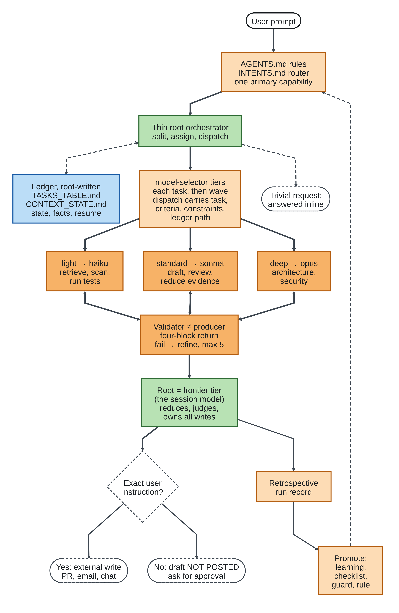

# LLM Toolkit for Data Science Projects

A generic, IDE-agnostic toolkit for LLM-assisted development: **rules** (always-on or loaded on demand), step-by-step **workflows**, on-demand **skills**, reusable **tool subagents**, review **rubrics**, integration guides, captured **learnings**, and cross-platform setup/validation **scripts**. It works with Codex, Cursor, Claude Code, Windsurf, GitHub Copilot, Gemini CLI, OpenCode, Antigravity, and generic agents.

The toolkit is the single source of truth. Consumer projects link to it (symlinks or junctions) plus a few generated pointer files; they never copy canonical content. Keep generic guidance here and repository-specific details in the consumer's own `AGENTS.md` and `docs/llm/`. A small set of assets is scoped to this toolkit's own data-science/thesis context and is labelled as such.

## What Is Included

| Area | Path | Purpose |
| --- | --- | --- |
| Rules | `rules/` | 23 short constraints (15 always-on, 8 loaded on demand): git, security gates, knowledge base first, request orchestration, model selection, human-reply gate, external-write authorization, CLI-over-MCP, cross-platform scripts, workflow authoring, workflow self-improvement |
| Workflows | `workflows/` | 71 sequenced procedures: review, knowledge-base sync, PR/ticket validation, releases, specialist validation/evolution pairs, docs and diagrams, study-to-publication and run retrospectives, infrastructure and log investigation, data-science and thesis work |
| Skills | `skills/` | 64 on-demand capabilities with progressive disclosure (`SKILL.md` + `references/`, `rules/`, `scripts/`, `agents/`) |
| Tool subagents | `tool-subagents/` | 15 shared subagent prompts (`.md`) rendered into `.cursor/agents`, `.claude/agents`, and `.codex/agents` (generated TOML), led by `agent-orchestrator` |
| Rubrics | `rubrics/` | Architecture severity calls and the technical-content scoring rubric |
| Integrations | `integrations/` | Jira, Confluence, AWS CLI, Slack CLI setup guides |
| Clients | `clients/` | Provider overlay guidance and client sync commands |
| Learnings | `learnings/` | 37 indexed trial-and-error discoveries (AWS, Terraform, Confluence, git/Windows/shell, agent behavior, notebooks, publishing) |
| Scripts | `scripts/` | Setup, link repair, sync, machine bootstrap, security gate, index validation, changed-code quality gate, LLM-surface scan, PDF export, plugin catalog and scan (`scripts/plugins.py`, guide `docs/plugins.md`) |
| Tests and CI | `tests/`, `.github/workflows/` | Unit tests for the validators and GitHub Actions that run the full gate on `main` |
| Knowledge base | `kb/`, `scripts/kb.py` | Local vector index of this toolkit plus a pending inbox; agents search it first and write reusable knowledge back (`rules/knowledge-base.md`) |
| Docs | `docs/` | Provider path map, repo setup prompt, Jira setup |

## Architecture

Canonical content lives in one place; provider directories are thin compatibility surfaces:

```text
rules/             broad always-relevant guidance (always loaded)
workflows/         manually invoked procedures (<= 12,000 characters each)
skills/            on-demand capabilities
tool-subagents/    reusable subagent prompts (.md; Codex TOML generated, not committed)
rubrics/           review scoring and checklists
learnings/         indexed gotchas (read learnings/INDEX.md first)

.agents/skills .claude/skills .codex/skills .cursor/skills .windsurf/skills   -> skills/
.agent/skills .gemini/skills .opencode/skills                                 -> skills/
.windsurf/rules                                                               -> rules/
.windsurf/workflows                                                            -> workflows/
.cursor/rules/*.mdc                                                           generated from rules/ (git-ignored per file)
.cursor/agents .claude/agents .codex/agents                                   -> tool-subagents/ (rendered)
```

`docs/tool-compatibility-paths.md` is the single path map. Repair links and refresh generated surfaces from the toolkit root with:

```bash
./scripts/sync-tool-configs.sh . --skip-agents-md --skip-github
```

```powershell
.\scripts\sync-tool-configs.ps1 . -SkipAgentsMd -SkipGithub
```

### Orchestration architecture



A thin root routes each non-trivial request and assigns every task a tier (light -> haiku, standard -> sonnet, deep -> opus); a validator that is never the producer checks each return before the root accepts it. The root alone writes the ledger (`TASKS_TABLE.md` + `CONTEXT_STATE.md`) and performs external writes, which stay behind the write gate. The other figures and how to regenerate them are in [`docs/diagrams/README.md`](docs/diagrams/README.md).

### How agents use it

1. **Rules** travel with every request (`rules/request-orchestration.md` routes non-trivial work; `rules/security-check-required.md`, `rules/human-comment-reply-gate.md`, and `rules/external-write-authorization.md` gate side effects).
2. **`agent-orchestrator`** (`tool-subagents/agent-orchestrator.md`) splits multi-lane work into a wave-ordered task table, assigns each task a complexity tier and concrete model through `model-selector`, runs every delegated task as a bounded produce-validate-refine loop (`workflows/task-quality-loop.md`, max 5 iterations), keeps a durable state ledger (`CONTEXT_STATE.md` + `TASKS_TABLE.md`), and enforces a 30-minute SLA per task.
3. **Read-only specialists** (`pr-validator`, `java-change-validator`, `documentation-reviewer`, `aws-alarm-investigator`, `log-analyst`, `diagram-creation-specialist`, `prod-doc-promoter`, `task-quality-judge`, `verifier`, ...) return evidence, findings, and draft replies; the root agent owns edits, commits, pushes, and human-facing replies.
4. Each specialist ships as a **skill** entrypoint plus a **validation** workflow and an **evolution** workflow; `workflows/specialist-agent-factory.md` creates new ones.

## Quick Start

### First time on a machine

```bash
./INFRA.sh              # plan only: git, node, python, jq, ripgrep, gh, aws, mvn, ast-grep, repomix, agent CLIs
./INFRA.sh --apply      # install the full profile
```

Windows PowerShell: `.\INFRA.ps1` plans, `.\INFRA.ps1 -Apply` installs. Both wrap `scripts/bootstrap-dev.sh|.ps1`, are idempotent, print installed/missing tools, and leave every authentication step (`gh auth login`, `aws configure sso`, Atlassian CLI) interactive.

### Use the toolkit in every session (user-level install)

To make this toolkit the default source of skills, subagents, rules, and workflows for every LLM tool on the machine, in every project, install it at the user level:

```bash
./scripts/install-global-surfaces.sh            # plan: shows what would be linked/written
./scripts/install-global-surfaces.sh --apply    # links ~/.claude, ~/.codex, ~/.cursor, ~/.codeium/windsurf, ~/.gemini, ... to this toolkit
```

```powershell
.\scripts\install-global-surfaces.ps1 -Apply
```

It links each tool's home-directory skill path to `skills/` (and, for Claude Code, Codex, and Cursor, the agent path to `tool-subagents/`), and writes a managed block into each tool's global instruction file (`~/.claude/CLAUDE.md`, `~/.codex/AGENTS.md`, `~/.gemini/GEMINI.md`, Windsurf `global_rules.md`) that routes every non-trivial prompt through `rules/request-orchestration.md` and `tool-subagents/agent-orchestrator.md`. Re-run after `git pull`; see `docs/global-install.md` for the per-tool table, the Cursor manual step, and uninstall.

### Knowledge base (optional, per machine)

A local vector knowledge base (Docker) indexes this toolkit so agents search it before reading source and save new knowledge to a pending inbox that the agent sync workflow promotes through a pull request. Setup, configuration, and security: `docs/knowledge-base.md`; commands: `skills/knowledge-base/SKILL.md`.

### Use in another repo

Clone this toolkit next to a consumer project, then run the setup script from the consumer repo:

```bash
../llm-toolkit-project/scripts/setup-repo.sh .
```

```powershell
..\llm-toolkit-project\scripts\setup-repo.ps1 .
```

The setup scripts create or repair toolkit links for every supported provider, scaffold `docs/llm/` (README, `toolkit-selection.txt`, rules and workflows folders), generate local `scripts/sync-llm-configs.*` wrappers, `.cursorignore`/`.cursorindexingignore`, a `CLAUDE.md` that imports `AGENTS.md`, Copilot instructions, and the managed `AGENTS.md` toolkit block, and update `.gitignore`. Windows directory links need Developer Mode or an elevated shell (`setup-repo.cmd` requires an Administrator prompt). If scripted setup is blocked, use `docs/repo-setup-prompt.md` as an LLM-guided repair prompt.

After setup, hand this prompt to the agent inside the consumer repo:

> I just ran `setup-repo` from our shared LLM toolkit. Walk me through the configuration steps in AGENTS.md, help me curate `docs/llm/toolkit-selection.txt`, and add repo-local context under `docs/llm/`.

### Selecting context

Consumer repos curate shared context in `docs/llm/toolkit-selection.txt`:

```text
rules/security-check-required.md
rules/request-orchestration.md
workflows/pre-pr-check.md
workflows/run-tests.md
```

Then refresh generated exports from the consumer repo with `scripts/sync-llm-configs.sh` (Bash) or `scripts\sync-llm-configs.ps1` (PowerShell). Refresh links after toolkit updates with `../llm-toolkit-project/scripts/ensure-symlinks.sh . --pull` (add `--force` to replace blocking local paths).

## Rules

| Rule | File | Scope |
| --- | --- | --- |
| **API Contract Surface** | `rules/api-contract-surface.md` | Contract changes must identify downstream consumers, gateways, and generated artifacts |
| **Changed-Code Quality Gate Required** | `rules/changed-code-quality-gate-required.md` | Blocking static-analysis gate scoped to added or modified lines |
| **CI Feedback Loop** | `rules/ci-feedback-loop.md` | Turn CI failures into rule and workflow updates |
| **CLI over MCP** | `rules/cli-over-mcp.md` | Prefer capable authenticated CLIs; record why MCP was chosen when it is |
| **Command Safety** | `rules/command-safety.md` | Review shell commands for destructive, exfiltration, or injection risk |
| **Cross-Platform Scripts** | `rules/cross-platform-scripts.md` | Scripts must run on Windows, Linux, and macOS |
| **Documentation Review Required** | `rules/documentation-review-required.md` | Route created or changed documentation through `documentation-reviewer` |
| **Error-Driven Learning** | `rules/error-driven-learning.md` | Capture trial-and-error wins as indexed learnings |
| **External Write Authorization** | `rules/external-write-authorization.md` | Bind every external mutation (tickets, PRs, wiki, chat, email) to an explicit instruction |
| **Git Conventions** | `rules/git-conventions.md` | Branch naming, protected-branch etiquette, semantic commits, rebase, duplicate-file gate |
| **Human Comment Reply Gate** | `rules/human-comment-reply-gate.md` | Draft-and-approve gate for human-facing replies |
| **Knowledge Base** | `rules/knowledge-base.md` | Query the KB before reading source; write-back through an intake gate (dedupe, security, classification, indexes); improvement check |
| **Log Analysis Safety** | `rules/log-analysis-safety.md` | Read-only, bounded, redacted log analysis |
| **Multi-Agent Orchestration** | `rules/multi-agent-orchestration.md` | Parallel fanout, tier and validator handoff, when to serialize |
| **Operational Doc Required** | `rules/operational-doc-required.md` | Recurring operations become runbooks; metric catalogs and wiki backup gates |
| **Publication Positioning** | `rules/publication-positioning.md` | Read the consumer's publication profile first; AIDA order, budgets, sourced claims, `NOT POSTED` drafts, a profile check before any draft is shown as ready, and owner approval before posting |
| **Plugin Governance** | `rules/plugin-governance.md` | On demand: capability selection across toolkit assets and plugins; trust tiers, scanner verdicts, owner-gated adds and removals, protective plugins |
| **Release Safety** | `rules/release-safety.md` | Deploy order, verification, rollback, completion evidence |
| **Repository Context Layers** | `rules/repository-context-layers.md` | How toolkit rules merge with repo-local `AGENTS.md` and provider pointers |
| **Request Orchestration** | `rules/request-orchestration.md` | Routing into specialists, model-selection contract, quality loops, safety boundaries |
| **Security Check Required** | `rules/security-check-required.md` | Mandatory security gate incl. LLM-surface prompt-injection scan and skill scanners |
| **Workflow Authoring** | `rules/workflow-authoring.md` | 12K size limit, splits, single responsibility, composition |
| **Workflow Self-Improvement** | `rules/workflow-self-improvement.md` | Every non-trivial workflow or agent run: preflight, capture, run record, promotion, measured trend; metrics are diagnostic only |

Templates for consumer-specific rules live in `rules/examples/`.

## Workflows

See `docs/catalog/workflows.md` for the categorized catalog of all 71 workflows. Highlights:

| Workflow | Use when |
| --- | --- |
| `workflows/task-quality-loop.md` | Every delegated task: produce, validate with a read-only validator, refine (max 5 iterations) |
| `workflows/pre-pr-check.md`, `workflows/changed-code-quality-gate.md`, `workflows/commit-and-push.md` | Validation gate, changed-code static analysis, semantic commit regrouping and safe push |
| `workflows/ticket-review.md` | Report-only review |
| `workflows/ticket-implementation.md`, `workflows/ticket-research-and-implementation-and-validation.md` | Implement, or research, implement, and validate a ticket |
| `workflows/pr-validator-validation.md`, `workflows/java-change-validation.md`, `workflows/documentation-reviewer-validation.md` | Read-only specialist validation passes |
| `workflows/aws-alarm-investigator-validation.md`, `workflows/log-investigation.md` | Infrastructure, pipeline, alarm, and log investigations |
| `workflows/diagram-creation-specialist-validation.md`, `workflows/confluence-documentation.md`, `workflows/markdown-pdf-export.md` | Docs, diagrams, wiki, and PDF export |
| `workflows/specialist-agent-factory.md`, `workflows/context-compaction.md` | Growing and maintaining the toolkit itself |
| `workflows/thesis-writing-main.md`, `workflows/data-pipeline-change.md` | Data-science and thesis work |
| `workflows/study-publication-medium-linkedin.md` | Publish a merged study repo: short system-design-first Medium article and LinkedIn teaser in AIDA order, a validation gate before every draft, drafts-only mode, README link PRs, back-links, and a replace-published-story path behind separate approval gates |
| `workflows/run-retrospective.md` | End-of-run retrospective: capture signals, classify mistakes, append the run record, promote recurring mistakes, report trend metrics |
| `workflows/knowledge-base-sync.md` | Scheduled sync: intake-gate new knowledge, promote it on one rolling pull request, archive inbox items after the merge |
| `workflows/resource-value-check.md` | Mandatory gate before adding a skill, workflow, agent or rule: blind race of the resource against the plain model; add only if it wins |

All workflows by area:

- **Orchestration and toolkit evolution:** `workflows/task-quality-loop.md`, `workflows/agent-orchestrator-validation.md`, `workflows/agent-orchestrator-evolution.md`, `workflows/model-selector-validation.md`, `workflows/model-selector-evolution.md`, `workflows/specialist-agent-factory.md`, `workflows/context-compaction.md`, `workflows/automation-maintenance.md`, `workflows/capture-learning.md`, `workflows/run-retrospective.md`, `workflows/knowledge-base-sync.md`, `workflows/assistant-workspace-cleanup.md`, `workflows/conversation-monitoring.md`, `workflows/workspace-hygiene-auditor-validation.md`, `workflows/workspace-hygiene-auditor-evolution.md`, `workflows/resource-value-check.md`
- **Core engineering:** `workflows/project-discovery.md`, `workflows/ticket-review.md`, `workflows/pre-pr-check.md`, `workflows/changed-code-quality-gate.md`, `workflows/run-tests.md`, `workflows/update-docs.md`, `workflows/commit-and-push.md`, `workflows/environment-diagnose.md`
- **Tickets, PRs, CI, releases:** `workflows/ticket-implementation.md`, `workflows/ticket-research-and-implementation-and-validation.md`, `workflows/pr-validator-validation.md`, `workflows/pr-validator-evolution.md`, `workflows/java-change-validation.md`, `workflows/gh-address-comments.md`, `workflows/gh-fix-ci.md`, `workflows/pr-automation-review.md`, `workflows/security-check-required.md`, `workflows/security-report.md`
- **Infrastructure, operations, logs:** `workflows/aws-alarm-investigator-validation.md`, `workflows/aws-alarm-investigator-evolution.md`, `workflows/log-investigation.md`, `workflows/aws-airflow-terraform-change.md`, `workflows/aws-airflow-terraform-project.md`, `workflows/aws-data-platform-ops.md`, `workflows/folder-reorganization.md`, `workflows/third-party-installer-vetting.md`
- **Documentation, diagrams, wiki:** `workflows/documentation-reviewer-validation.md`, `workflows/documentation-reviewer-evolution.md`, `workflows/diagram-creation-specialist-validation.md`, `workflows/diagram-creation-specialist-evolution.md`, `workflows/confluence-documentation.md`, `workflows/prod-doc-promoter-validation.md`, `workflows/prod-doc-promoter-evolution.md`, `workflows/markdown-pdf-export.md`, `workflows/study-publication-medium-linkedin.md`, `workflows/technical-content-publishing.md`
- **Data science, thesis, notebooks, pipelines:** `workflows/project-execution-main.md`, `workflows/notebook-analysis-update.md`, `workflows/notebook-to-script.md`, `workflows/notebook-latex-polish.md`, `workflows/ml-experiment-update.md`, `workflows/thesis-writing-main.md`, `workflows/thesis-chapter-writing.md`, `workflows/thesis-plagiarism-check.md`, `workflows/data-source-ingestion.md`, `workflows/data-source-storage-backend.md`, `workflows/dataset-onboarding.md`, `workflows/data-pipeline-change.md`
- **Career and job search:** `workflows/job-search-pipeline.md`, `workflows/career-profile-sync.md`, `workflows/job-portal-profile-sync.md`, `workflows/job-search-attack-plan.md`, `workflows/recruiter-legitimacy-check.md`, `workflows/screening-interview-quick-prep.md`, `workflows/technical-interview-prep.md`

## Skills at a Glance

Full catalog with conventions: `skills/README.md`. Invoke by intent (`INTENTS.md`) or name.

#### Orchestration And Context Engineering

| Skill | Purpose |
| --- | --- |
| **agent-orchestrator** | Capability-first routing, safe parallel delegation, per-task model tiering, bounded quality loops, durable state ledger, and explicit LOA mode |
| **model-selector** | Assign every task a complexity tier, concrete model, effort, and token band before it runs; audit finished task tables for overspend |
| **specialist-agent-factory** | Create or update reusable specialist agents (subagent prompt, validation/evolution workflows, skill entrypoint, routing, provider overlays) |
| **token-efficiency** | Reduce token consumption: command-output compaction (RTK), `gh --json`/`jq` field selection, ripgrep budgeting, ast-grep, repomix packing |
| **llm-context-engineering** | Keep AGENTS/rules/workflows/skills lean, generic, provider-agnostic, and loaded on demand |
| **llm-toolchain-provisioning** | Export, review, and restore installed LLM assistant extensions (plugins, marketplaces, MCP servers) as a portable manifest |
| **external-skill-intake** | Safely evaluate, download, adapt, scan, and index skills from public LLM-tool repositories |
| **error-driven-learning** | Always-on discipline: read `learnings/INDEX.md` before work and capture trial-and-error discoveries after it |
| **onboarding** | Get started with this toolkit in a repo, or add it to one |
| **project-discovery** | Understand a project: structure, architecture, flows, how-tos, related projects |
| **design-driven-dev** | Investigation-first Socratic design process before coding |
| **pathfinder** | CoLD-based vertical slicing of design docs and implementation plans |
| **second-opinion** | Dual-model side-by-side sanity check of plans, designs, or code |
| **cli-creator** | Build durable command-line tools and companion skills from API docs, specs, or scripts |
| **run-retrospective** | End-of-run retrospective: run records, mistake signatures, promotion ladder (learning, checklist, guard, rule), and trend metrics via `run_retro.py` |
| **knowledge-base** | Search the toolkit knowledge base before reading source, run the intake gate, save to the pending inbox, set up and check the local vector KB via `scripts/kb.py` |
| **assistant-workspace-cleanup** | Inventory, classify, and safely clean up an AI-assistant workspace (chats, agent sessions, projects, scheduled tasks, artifacts, ledgers) behind a reversibility-grouped approval gate, ID allow-listed lanes, and live-state verification |
| **workspace-hygiene-auditor** | Read-only specialist that turns a workspace inventory into a classified cleanup plan (one action, confidence, and reason per item) and flags stale-state, coverage-gap, and run-duration risks |
| **repeat-work-discovery** | Scan mail, calendar, and files for repeated work, return a ranked top-5 list of proposed skills with trigger, time saved, and tool recommendations, and build the approved ones |
| **productivity-impact-estimate** | Estimate weekly, monthly, and yearly engineering time saved by the toolkit with a transparent, reproducible model, labelled as an estimate and not a measurement |

#### Engineering Practices And Languages

| Skill | Purpose |
| --- | --- |
| **best-practices** | SOLID, clean code, layered architecture, resilience, anti-patterns |
| **js-ts-best-practices** | JavaScript/TypeScript patterns: async, type safety, DI, Node/TS toolchain choices |
| **python-best-practices** | Python patterns: typing, DI, concurrency, packaging, testing |
| **testing** | AC traceability, test pyramid, mocking, coverage, and test patterns |
| **run-tests** | Pick and run the smallest meaningful validation for a change set |
| **git-conventions** | Branch naming, semantic commits, PR lifecycle, rebase workflow, duplicate-file gate |
| **environment-diagnose** | Diagnose local environment, auth, Docker, cache, and setup issues |
| **local-env-bootstrap** | Bootstrap or repair a local development environment across repos |
| **web-form-submit-debugging** | Diagnose a web form whose Next or Submit button does nothing: read validation, capture network and console, instrument the page, rule out extensions, then pick a workaround or report a site defect |

#### Review, Validation, And Quality Gates

| Skill | Purpose |
| --- | --- |
| **ticket-review** | In-agent diff review scoped to a ticket, PR, or branch (report only) |
| **pre-pr-check** | Full pre-PR gate: repo validations, changed-code quality gate, UI-verify check, in-agent review |
| **pr-validator** | Read-only PR/ticket readiness validation on the live head with approve-ready, blocked, or monitor reporting |
| **java-change-validator** | Read-only Java diff, test, framework wiring, migration, and build-evidence validation before merge or reply |
| **documentation-reviewer** | Read-only review of docs, runbooks, PR bodies, release notes, and generated surfaces for source-grounded accuracy |
| **ui-verify** | Verify front-end changes in a real browser through any configured browser MCP before declaring work done |

#### CI, Releases, And Delivery

| Skill | Purpose |
| --- | --- |
| **jenkins-to-github-actions** | Migrate Jenkins pipelines to GitHub Actions safely |
| **maven-release** | Maven release: prepare, perform, Nexus deployment, downstream updates |
| **maven-build-troubleshooting** | Diagnose Maven build, OWASP dependency-check, Java runtime, and local webapp startup failures |

#### Operations, Infrastructure, And Cloud

| Skill | Purpose |
| --- | --- |
| **runbook-authoring** | Structured operational runbooks for deploy, triage, rollback, and recurring operations |
| **incident-ops** | Incident triage, mitigation, communication, and observability-gap recovery |
| **log-analysis** | Read-only CloudWatch, server, access, Log4j, Lambda, Glue, and Firehose log investigation with redaction |
| **aws-alarm-investigator** | Read-only CloudWatch alarm root-cause investigation with confidence-rated hypotheses and email-ready fixes |
| **terraform-change-safety** | Terraform change-safety patterns: `terraform_data` lifecycle, module variable wiring, alarm first-datapoint planning, alias-qualified permissions |
| **folder-reorganization** | Reorganize a folder tree (renames, moves, archive) without breaking automations, scripts, documents, or cloud-sync links: approval-first proposal, path map, resumable scripted run with rollback, verification against live consumers |
| **aws-airflow-terraform-project** | Repository-specific AWS Airflow Terraform guidance for the data-science project (toolkit-local context) |

#### Security

| Skill | Purpose |
| --- | --- |
| **security-best-practices** | Language- and framework-specific secure-by-default reviews |
| **security-ownership-map** | Git-based security ownership topology, bus factor, and sensitive-code ownership |

#### Documentation, Diagrams, And Wiki

| Skill | Purpose |
| --- | --- |
| **doc-delta** | Suggest or apply documentation updates from staged changes |
| **update-docs** | Keep docs aligned with code changes |
| **document-conversion** | Convert between PDF, DOCX, PPTX, XLSX, and Markdown (thesis exports, reports) |
| **diagram-authoring** | Create, validate, and export deterministic high-resolution C4, AWS, sequence, and flow diagrams with mandatory image QA |
| **diagram-creation-specialist** | Read-only source-grounded diagram planning, notation, export, and image-quality validation |
| **system-architecture-specialist** | Read-only application architecture, boundary, data-flow, integration, and quality-attribute review |
| **confluence-documentation** | Safe Confluence CRUD, hierarchy, labels, comments, attachments, and rollback-state backups |
| **prod-doc-promoter** | Read-only promotion planning for deployed-ticket documentation from a wiki intake folder to canonical homes |
| **markdown-pdf-export** | Generate and verify ticket-ready PDFs from Markdown (HTML+Chrome for tables, Kroki+Pandoc for diagrams) |
| **technical-content-publishing** | Turn a software project into evidence-grounded Medium-style article, LinkedIn post and carousel, cover image, and architecture diagram as reviewed drafts, never posted |
| **current-events-briefing** | Brief the user on a live or just-finished public event with symmetric coverage, independent analysis, fact-checker findings, same-pollster comparisons, and an honest "no consolidated verdict yet" |

#### Data Science, Notebooks, And Pipelines

| Skill | Purpose |
| --- | --- |
| **jupyter-notebook** | Notebook hygiene: kernel state, cell order, outputs, review, promotion to scripts |

#### Career And Job Search

| Skill | Purpose |
| --- | --- |
| **job-search-pipeline** | Profile-driven job scan: board discovery and hard-rule screening, owner-approved applications, inbox/board status reconciliation, guarded xlsx tracker updates, skill-gap mapping, ranked digest |
| **credential-evaluation** | Decide whether a degree, MBA, master's, bootcamp, or certification is worth it for someone's career: who really awards it, legal recognition where it will be used, market signal, opportunity cost, and accredited alternatives. |
| **contract-platform-vetting** | Vet AI-training and expert-contractor marketplaces as bridge income: legitimacy check, rate selection inside the posted band, ranking by band and task fit, effective-hourly math, weekly-hour caps |
| **interview-prep-planner** | Build an interview-preparation plan: classify interview types, gap analysis against the profile, prioritized study plan with resources and drills, week-one triage, STAR prompts, and a resumable deliverable |
| **technical-interview-prep** | Coach a candidate through one technical interview: truthful cheat sheet, intro rehearsal, Java coding-pattern drills, full mock with end-of-session scoring, and a debrief that turns the asked problem into the next drill |

---

## Tool Subagents

`tool-subagents/README.md` lists all 15 shared subagents and the delegation contract (objective, scope, constraints, allowed tools, write ownership, acceptance criteria, validator, loop budget, complexity tier). `agent-orchestrator` is the default coordinator; `model-selector` assigns tiers; `task-quality-judge` and `verifier` judge results; the read-only specialists cover PRs, Java, docs, wiki promotion, diagrams, alarms, logs, tests, releases, and workspace hygiene.

## Integrations

| Integration | File | Purpose |
| --- | --- | --- |
| **Jira** | `integrations/jira.md` | Ticket details, search, issue management (CLI + MCP); getting-started walkthrough in `docs/jira-setup.md` |
| **Confluence** | `integrations/confluence.md` | Documentation, wikis, architecture pages (CLI + MCP) |
| **AWS CLI** | `integrations/aws-cli.md` | Cloud infrastructure, deployment, logs |
| **Slack CLI** | `integrations/slack-cli.md` | Slack application development with pinned installation |

## Validation

Before committing toolkit changes, run the gate (Bash / Git Bash):

```bash
./scripts/validate-toolkit-indexes.sh          # indexes, frontmatter, path references, workflow sizes, genericity
./scripts/security-check-toolkit.sh            # secrets, static analysis, LLM-surface scan, skill scanners, lint
./scripts/validate-skills-with-skillspector.sh --changed
npm run validate                               # node validators (skills index, rules redirects, sizes, subagents) + always-on size check + python tests
```

PowerShell:

```powershell
.\scripts\validate-toolkit-indexes.ps1
.\scripts\security-check-toolkit.ps1
.\scripts\validate-skills-with-skillspector.ps1
npm run validate
```

The gate checks skill frontmatter, referenced paths, the 12,000-character workflow limit, subagent `.md` renderability to the Codex TOML (`name`, `description`, `developer_instructions`), cloud-sync duplicates, project-specific leak patterns (`FORBIDDEN_PROJECT_PATTERNS`), prompt-injection patterns in LLM surfaces (`scripts/scan-llm-surface-security.py`), and runs every installed scanner (gitleaks, semgrep, shellcheck, PSScriptAnalyzer, yamllint, actionlint, hadolint, syft/grype/trivy, SkillSpector). Missing scanners are skipped with a reason; set `SECURITY_ALLOW_ALL_SKIPPED=1` only for local runs without any scanner. `.github/workflows/validate.yml` runs the same gate in CI, and `changed-code-quality-gate.yml` runs the changed-code static analysis on pull requests.

## Safety

- Do not commit secrets, credentials, private hostnames, ticket-specific content, real customer or organization names, or copied consumer payloads.
- Do not commit cloud-sync duplicates such as `file (1).md`.
- Keep generated consumer exports local unless they are intentionally part of this toolkit.
- Prefer links and generated compatibility surfaces over duplicated tool-specific copies.
- Read-only specialists never edit or post; human-facing replies and external writes need explicit approval (`rules/human-comment-reply-gate.md`, `rules/external-write-authorization.md`).

## Useful Entry Points

- `AGENTS.md` - agent guidance, core principles, and the always-loaded routing index
- `INTENTS.md` - phrase-to-capability map
- `docs/catalog/workflows.md`, `skills/README.md`, `rules/README.md`, `tool-subagents/README.md` - catalogs
- `learnings/INDEX.md` - one-line index of every captured learning
- `docs/knowledge-base.md` - local vector knowledge base: setup, CLI, scheduled sync
- `docs/plugins.md` - plugin catalog, security scan, recommend, and decision register (`scripts/plugins.py`)
- `docs/tool-compatibility-paths.md` - provider path map
- `docs/repo-setup-prompt.md` - LLM-guided consumer setup
